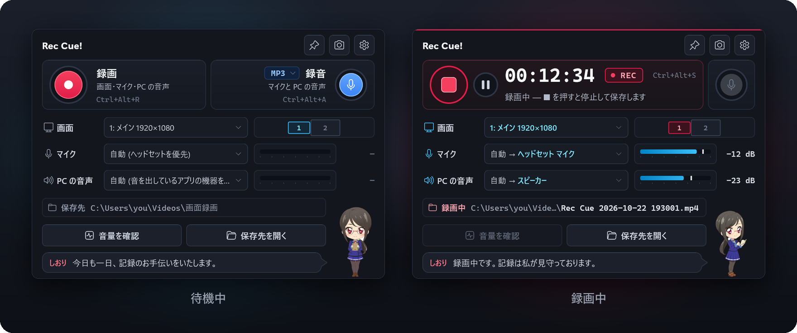
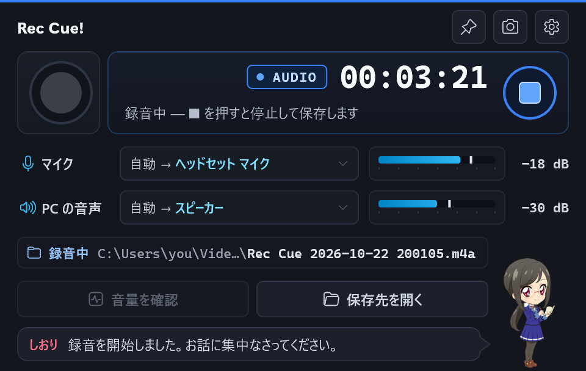
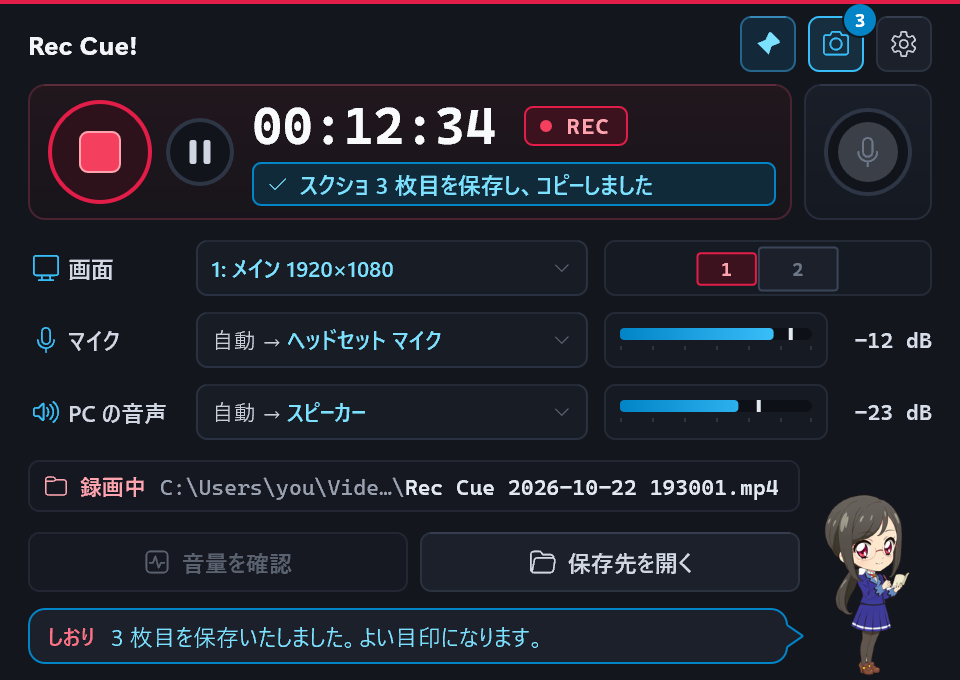
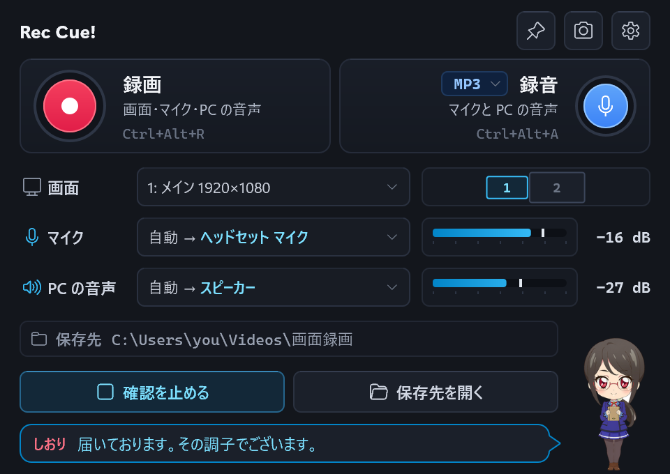
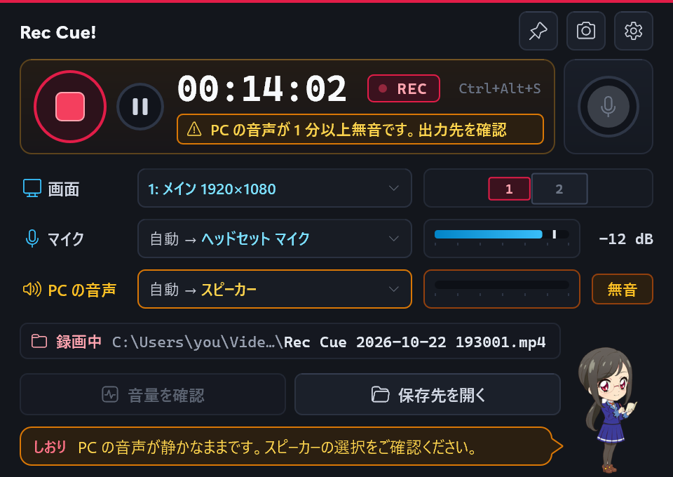
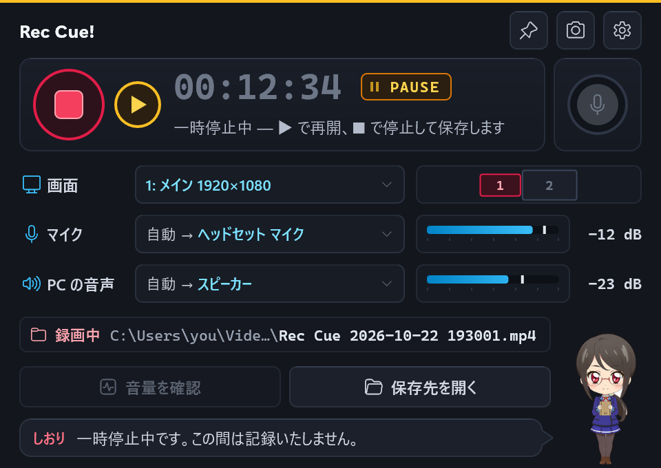
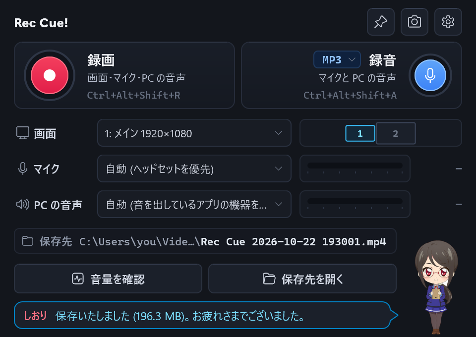
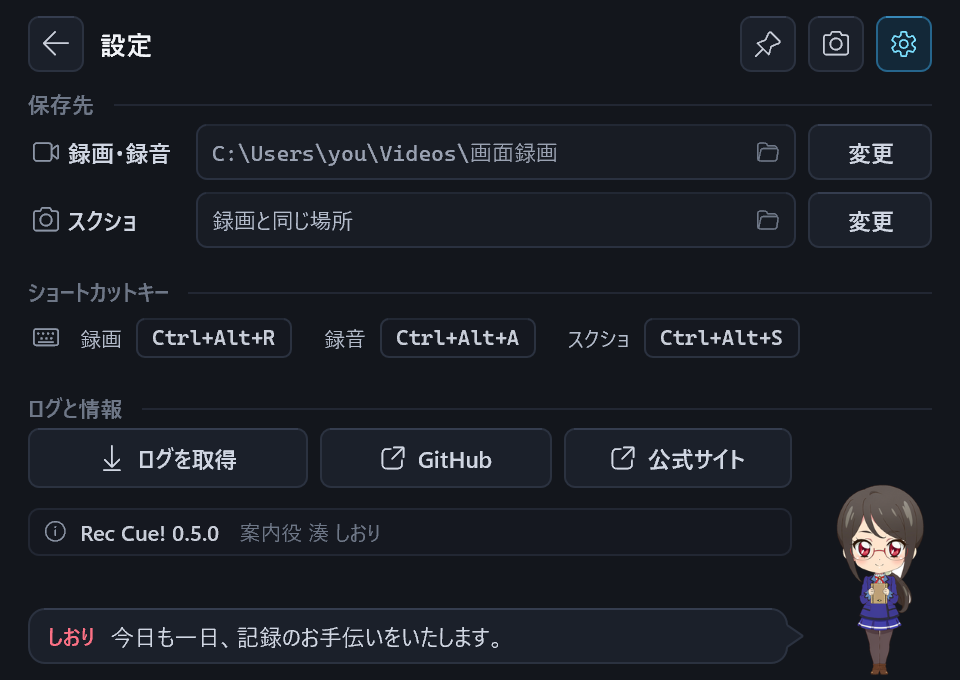
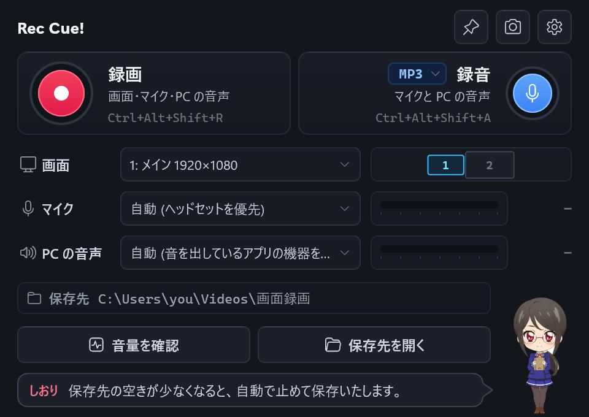
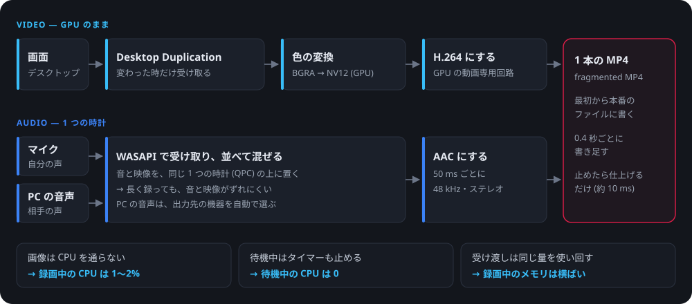

<p align="center"></p>

# Rec Cue!

[](https://github.com/keigoly/rec-cue/stargazers)
[](LICENSE)


画面全体・マイク・PC の音声 (会議や通話の相手の声) を **1 本の MP4** に録る、軽い録画アプリです。Windows 版と、Mac 版 (試作) があります。
Windows 版は、画面を GPU のまま取り込んで GPU で H.264 にするので、録画中の CPU は 1〜2%、待機中は 0 です。単体の exe 1 つ (約 1.2 MB) で動きます。

A lightweight screen recorder for Windows (and macOS 15+, preview) that puts the whole screen, your microphone and the PC's audio (the other side of a call) into one MP4. On Windows, capture and encoding stay on the GPU, so recording takes about 1–2% CPU and idling takes none.

> **Mac 版 (試作)** は macOS 15 以降で、ソースからビルドして使います (「[Mac 版](#mac-版)」)。ビルド済みの Mac のアプリは配布していません。

<p align="center"></p>

| 録音だけ (マイクと PC の音声を MP3・WAV・M4A に) | 録画中のスクショ (Rec Cue! の窓は写りません) |
|---|---|
|  |  |
| **音量の確認 (会議の前に)** | **PC の音声が 1 分以上無音なら知らせる** |
|  |  |
| **一時停止 (▶ で再開・止めていた間は入りません)** | **保存したところ** |
|  |  |
| **設定 (歯車で切り替え・保存先はエクスプローラーで選ぶ)** | **しおりのヒント (クリックで別のひとこと)** |
|  |  |

<sub>画面の音量・機器名・フォルダーは見本です (`rec-cue.exe --ui-snapshot` で描いたもので、実際の PC の画面ではありません)。</sub>

## できること

- **1 本の MP4 に**: 画面全体 (H.264) と、マイクと PC の音声を混ぜた音 (AAC) を 1 本のファイルに録ります。自分の声も相手の声も同じファイルに入ります
- **録音だけ**: 画面を録らずに、マイクと PC の音声を録ります。形式は録音の帯の「MP3」で **MP3** (既定・小さく、どこでも再生できる)・**WAV** (圧縮しない)・**M4A** (AAC) から選べます
- **一時停止**: 録画中・録音中に ■ の隣の ❚❚ で止め、▶ で再開します。止めていた間は画面も音も入らず、1 本のファイルにつながります
- **録る画面を選べる**: 画面が複数あるときは「画面」の欄で選びます。右の小さな図に画面の並びと番号が出るので、どれを録るか分かります
- **タスクバーから操作**: タスクバーの Rec Cue! のアイコンにマウスを乗せると、サムネイルの下にボタンが出ます。待機中は 録画・録音、録画中は 一時停止 (再開)・停止 です。窓を最小化したままでも使えます
- **相手の声を録り損ねにくく**: PC の音声は「自動」で、既定のスピーカーと、アプリ (Teams・ブラウザー・ソフトフォンなど) が音を出している再生機器をすべて録り、録画中に増えた機器も足します。マイクも「自動」(ヘッドセットを優先) で、録画中に外れたら数秒で選び直します。PC の音声が 1 分以上無音のままなら知らせます
- **音量の確認**: 録る前に、マイクと PC の音声のメーターで音が来ているかを確かめられます
- **スクショ**: 待機中でも録画中でも、録画と同じ画面を PNG で保存し、クリップボードにもコピーします。**Rec Cue! の窓は写りません** (最前面に固定していても、後ろの画面がそのまま写ります)
- **最前面 (ピン)**: 窓をほかのアプリより手前に固定できます
- **設定の画面**: 歯車を押すと、窓の中が設定に切り替わります。録画・録音とスクショの保存先は、欄を押すとエクスプローラーで開き、「変更」でエクスプローラーの画面から選べます (書き込めるフォルダーか確かめてから使います)
- **録画中の印**: タスクバーのアイコンの右下で丸がゆっくり点滅し、画面の左上に小さな丸が点きます (録画は赤・録音は青)。どちらも録画とスクショには写りません。一時停止中は点滅が止まって ❚❚ になり、左上の丸は輪になります
- **ショートカット**: `Ctrl+Alt+R` で録画、`A` で録音、`S` でスクショ (どのアプリを使っていても効きます)
- **落ちても残る**: 最初から本番のファイル (fragmented MP4) に 0.4 秒ごとに書き足すので、途中でアプリや PC が落ちても、そこまでの録画は再生できます。「一時ファイルに録ってから保存する」工程がないので、止めてから保存まで 1 秒もかかりません
- **案内役の湊しおり**: 右下の秘書が、場面に合わせて吹き出しでひとこと話します (台詞は 1,142 本)
- **記録**: 1 行 1 JSON のログに、録画中 10 秒ごとのコマ数・コマ落ち・音量・メモリ・CPU を残します。歯車の設定の「ログを取得」で、直近 7 日のログと録画ごとの記録を 1 つの ZIP にまとめられます (不具合を知らせるときに、そのまま添付できます)

## 軽さ

| | 録画中 | 待機中 |
|---|---|---|
| CPU | 1〜2% | 0 |
| メモリ (private) | 約 180〜220 MB で横ばい | 約 40 MB |
| ファイル | 1 時間でおよそ 0.9 GB (1080p・15 fps・2 Mbps)。録音だけなら MP3 / M4A で 58 MB、WAV で 690 MB | — |

<sub>Windows 11・Intel Core i7 のノート PC (内蔵 GPU Iris Xe)・1920×1080 で測定。exe は約 1.2 MB (アイコン・案内役の絵・台詞を含む)。</sub>

<p align="center"></p>

- **画面は GPU の中だけで扱う**: 画面が変わったときだけ、Windows (DXGI Desktop Duplication) が新しい画像を GPU 上で渡します。それを GPU のメモリから出さずに色を変換し、GPU の動画専用の回路 (Intel Quick Sync など) で H.264 にします (Media Foundation)。CPU は画像に触れません
- **音は 1 つの時計に並べる**: マイクと PC の音声 (WASAPI のループバック) を、映像のコマと同じ時計 (QPC) の上に並べてから混ぜ、AAC にします
- **最初から本番のファイルに書く**: 0.4 秒ごとに区切って書く MP4 なので、止めたときは仕上げるだけ (約 10 ms) です
- **待機中は何もしない**: タイマーを止め、マウスや状態が変わったときだけ描き直します。録画中の受け渡しは決まった量のメモリを使い回すので、長く録っても増えません
- **Windows に最初から入っている部品だけ**: C++ で書いた 1 本の exe で、Electron・.NET・FFmpeg などの実行環境や外部のライブラリを使いません

## 案内役 湊しおり

| 待機中 | 録画中・録音中 |
|:---:|:---:|
|  |  |

右下の **湊 しおり** (みなと しおり) は、録画の段取りを手伝う秘書です。待機中は冊子を持ち、録画中と録音中は冊子に書き込んでいます。話し方は「きちんと秘書」(丁寧で控えめな敬語) です。

| 場面 | 台詞の例 |
|---|---|
| 開いたとき (時間帯・曜日・季節で変わる) | 今日も一日、記録のお手伝いをいたします。 |
| 録画中 | 録画中です。記録は私が見守っております。 |
| スクショ (何枚目か) | 3 枚目を保存いたしました。よい目印になります。 |
| 保存したとき (大きさ・長さ) | 保存いたしました (196.3 MB)。お疲れさまでございました。 |
| 警告 | PC の音声が静かなままです。スピーカーの選択をご確認ください。 |

- 台詞は 30 の場面に 1,142 本あり、時間帯・曜日・季節・録画の長さ・スクショの枚数などで選び分けます。同じ台詞は続けて出ません
- しおりか吹き出しをクリックすると、別のひとことを話します (待機中は使い方のヒントか雑談)
- 台詞を選ぶのは場面が変わったときだけです。台詞のために待機中に動くことはありません
- 台詞は [`res/shiori-lines.txt`](res/shiori-lines.txt) (1 行 1 台詞) にあり、ビルドで exe に入ります

## 動作環境

### Windows

- Windows 11 / Windows 10 バージョン 2004 以降 (64 ビット)。確認したのは Windows 11 です
- H.264 のハードウェアエンコーダーを持つ GPU を推奨します。確認したのは Intel の内蔵 GPU (Quick Sync) です。ハードウェアエンコーダーが無い PC では Windows のソフトウェアのエンコーダーで録る作りです (未確認・CPU を多く使います)
- Windows の N エディションでは、Media Feature Pack (Media Foundation) が必要です
- ランタイムのインストールは要りません

### Mac

- macOS 15 以降・Apple シリコン。確認したのは macOS 27 です
- ビルドに Command Line Tools が要ります (Xcode は不要)。手順は「[Mac 版](#mac-版)」にあります
- 画面収録とマイクの許可が要ります (初めて録るときに聞かれます)

## はじめ方

1. [Releases](https://github.com/keigoly/rec-cue/releases/latest) から `rec-cue.exe` をダウンロードします (「[ソースからビルド](#ソースからビルド)」もできます)。Mac 版は「[Mac 版](#mac-版)」へ
2. `rec-cue.exe` を好きなフォルダーに置いて開きます。インストーラーはありません。設定とログは `%USERPROFILE%\.rec-cue\` に置かれます
3. 署名のない exe なので、初回は Windows の SmartScreen の警告が出ることがあります
4. 新しい版にするときは、Rec Cue! を閉じてから、同じ場所の `rec-cue.exe` を新しいものに置き換えます。設定とログ (`%USERPROFILE%\.rec-cue\`) はそのまま引き継がれます。新しい exe でも、初回は SmartScreen の警告が出ることがあります

## 使い方

1. 会議の前に **「音量を確認」** を押し、マイクのメーターが声で動くこと、相手が話したときに「PC の音声」のメーターが動くことを確かめます。確認中と録画中は、選択欄に「自動 → いま使っている機器名」が出ます
2. 画面が複数あるときは、**「画面」の欄** で録る画面を選びます (右の図の番号と同じです。スクショと画面の左上の丸も、この画面です)
3. 中央の帯の左の **赤い丸** (または `Ctrl+Alt+R`) で録画を始め、もう一度押す (■ に変わっています) と保存します。録画中は時計の横に **REC** の札が出て、窓の上端に赤い線が引かれます
4. 席を外すときや見せたくない場面では、■ の隣の **❚❚** で一時停止します。**PAUSE** の札が出て時間が止まり、窓の上端の線は琥珀色になります。▶ で再開すると、同じファイルの続きに録ります
5. 保存先は `ビデオ\画面録画\Rec Cue 2026-10-22 193001.mp4` のような名前です (時刻は開始時刻)。「保存先を開く」で開きます。保存先は歯車の設定の「変更」で変えられます

中央の帯は普段は半分ずつで、**左が録画** (画面・マイク・PC の音声)、**右が録音だけ** (マイクと PC の音声) です。押した側が伸びて、時間が出ます。録画中と録音中は、もう片方は押せません。

タスクバーの Rec Cue! のアイコンにマウスを乗せると、サムネイルの下にボタンが出ます (音楽のアプリと同じ場所です)。

| いつ | ボタン |
|---|---|
| 待機中 | 録画 (赤い丸)・録音だけ (青いマイク) |
| 録画中・録音中 | 一時停止 (❚❚)・停止して保存 (■) |
| 一時停止中 | 再開 (▶)・停止して保存 (■) |

録り始めるボタン (録画・録音・再開) を押すと、サムネイルは閉じます (録画に写らないように。再開はサムネイルが消えてから録り始めます)。

上の帯の右のアイコン (マウスを乗せると説明が出ます):

- **ピン**: 窓を最前面に固定します。次に開いたときも同じ状態です
- **カメラ**: スクショを撮ります。保存先は既定で録画と同じフォルダー (歯車の設定で変えられます) で、録画中に撮った枚数がアイコンの角に出ます。クリップボードの履歴 (Win+V) とクラウドのクリップボードには載せません
- **歯車**: 窓の中を設定の画面に切り替えます (下の「[設定](#設定)」)。← ・歯車・Esc で元の画面に戻ります。録画を始めると元の画面に戻ります

キーボードでは Tab で項目を移り、Space か Enter で押せます (選択欄は ↓ でも開きます)。

録画中に画面がロックされたり管理者の確認画面が出たりした間は、映像は直前の画面のまま続き、音声は途切れずに録れます。ログオフやシャットダウンの前にはファイルを仕上げます。

### キー操作

| キー | 動作 |
|---|---|
| `Ctrl+Alt+R` | 録画の開始 / 停止 |
| `Ctrl+Alt+A` | 録音だけの開始 / 停止 |
| `Ctrl+Alt+S` | スクショ |

ほかのアプリが同じキーを使っているときは、そのキーは効きません。歯車の設定の「ショートカットキー」に、琥珀色で「使用中」と出ます。

### 相手の声やマイクが入らないとき

- **PC の音声** は既定で「自動」です。選択欄を押すと一覧が開き、機器ごとに音を出しているアプリ名が `← ms-teams.exe` のように出ます。相手の声が出ている機器を選べば決め打ちできます
- **マイク** は既定で「自動」です。ヘッドセット → (ヘッドセットが仮想ミキサーに占有されているときは、音が来ているミキサーの出力) → 通話用の既定 → 既定 の順に選びます
- 録画中に「PC の音声が 1 分以上無音です」と出たら、相手の声が出ている機器を選び直してください

## 設定

歯車を押すと、窓の中が設定の画面に切り替わります。変えた設定は次の録画・スクショから使われます。

- **保存先**: 「録画・録音」と「スクショ」の 2 つ。欄を押すとエクスプローラーでそのフォルダーを開き、「変更」でエクスプローラーのフォルダーの選択の画面 (今のフォルダーから) で選びます。書き込めないフォルダーは使いません。スクショは既定で「録画と同じ場所」で、録画と同じフォルダーを選ぶとこの既定に戻ります。録画中・録音中は「変更」を押せません
- **ショートカットキー**: 録画・録音・スクショのキー。ほかのアプリが使っているキーは琥珀色で「使用中」と出ます
- **ログと情報**: ログを取得 (下の「[ログ](#ログ)」)・GitHub・公式サイト・版

マイク・PC の音声・録る画面・録音の形式は、元の画面の欄と「MP3 ▾」で選びます。

<details>
<summary>設定が保存されるファイル (参考)</summary>

画面で選んだ設定は `%USERPROFILE%\.rec-cue\config.ini` (UTF-8・`キー=値`) に書かれます。ふだんは開く必要はありません。

| キー | 既定 | 内容 |
|---|---|---|
| `out_dir` | 空 = `ビデオ\画面録画` | 保存先 (設定の「変更」で選ぶと書き換わる) |
| `name_prefix` | `Rec Cue` | ファイル名の先頭 |
| `fps` | `15` | 1 秒あたりのコマ数 (1〜60) |
| `video_kbps` | `2000` | 映像のビットレート。1080p で 1 時間およそ 0.9 GB |
| `audio_kbps` | `128` | 96 / 128 / 160 / 192 (録画の AAC と、録音だけの MP3 / M4A) |
| `audio_format` | `mp3` | 録音だけの形式: `mp3` / `wav` / `m4a` (録音の帯の「MP3」で選ぶと書き換わる。録画はいつも MP4) |
| `monitor` | `0` | 録る画面。0 = メイン、1 以降 = ほかの画面 (「画面」の欄の番号から 1 を引いた数。欄で選ぶと書き換わる) |
| `cursor` | `1` | マウスカーソルを映す |
| `mic` | `auto` | `auto` / `default` / `communications` / `none` / 機器名の一部 |
| `system` | `auto` | `auto` / `default` / `communications` / `none` / 機器名 (`\|` で複数) |
| `mic_gain_db` / `system_gain_db` | `0` | 音量の補正 (-20〜20) |
| `container` | `fmp4` | `fmp4` (落ちても再生できる) / `mp4` |
| `hw_encode` | `1` | GPU のエンコーダーを使う |
| `latency_ms` | `150` | 音声を揃える待ち時間。音が途切れるときだけ大きくする |
| `hotkey` | `Ctrl+Alt+R` | 録画の開始と停止。`none` で無効 |
| `audio_hotkey` | `Ctrl+Alt+A` | 録音だけの開始と停止。`none` で無効 |
| `shot_hotkey` | `Ctrl+Alt+S` | スクショ。`none` で無効 |
| `shot_dir` | 空 = 録画と同じ場所 | スクショの保存先 (設定の「変更」で選ぶと書き換わる) |
| `shot_clipboard` | `1` | スクショをクリップボードにもコピーする |
| `topmost` | `0` | 窓を最前面に固定する (画面のボタンで切り替えると書き換わる) |
| `github_url` | `https://github.com/keigoly/rec-cue` | 設定の「GitHub」 |
| `site_url` | `https://official.keigoly.jp/` | 設定の「公式サイト」 |

</details>

## ログ

- `%USERPROFILE%\.rec-cue\logs\rec-cue-YYYYMMDD.log` — 1 行 1 JSON。各処理の所要 ms・成否・エラーと、録画中 10 秒ごとの統計 (コマ数・コマ落ち・音量・メモリとその内訳・CPU・PC の空きメモリ)
- `%USERPROFILE%\.rec-cue\sessions\<セッション ID>.json` — 録画・録音ごとのまとめ (長さ・大きさ・機器・音量・コマ落ち・CPU とメモリの山・録画中に撮ったスクショ)
- **ログを取得** (歯車の設定): 直近 7 日のログと録画ごとのまとめ、`config.ini`、版と Windows のビルドを 1 つの ZIP (`ダウンロード\Rec Cue ログ 2026-10-30 153012.zip` のような名前) にまとめ、エクスプローラーでそのファイルを選んだ状態で開きます。不具合を知らせるときは、この ZIP を添付してください。中に入るのは数字と状態・機器名・フォルダー名で、録画や録音の中身は入りません

### 途中で落ちたファイル

fMP4 なので、Windows の「メディア プレーヤー」や VLC ではそのまま再生できます。
Mac の QuickTime などで長さが 0 秒に見えるときは `ffmpeg -i 落ちたファイル.mp4 -c copy 直したファイル.mp4` で直ります。
録音だけの MP3 はそのまま、WAV は落ちる 1 秒ほど前までが再生できます (WAV の見出しの長さを 1 秒ごとに書き直しています)。

## Mac 版

Mac 版 (試作) は Swift で書き直したもので、`mac/` にあります。窓・案内役のしおり・ショートカット・設定とログの形は Windows 版にそろえています。ビルド済みのアプリは配布していないので、ソースからビルドします。

```sh
xcode-select --install      # 初回のみ: Command Line Tools (Xcode は不要)
git clone https://github.com/keigoly/rec-cue.git
cd rec-cue/mac
scripts/build.sh            # → build/Rec Cue.app (警告 0)
open "build/Rec Cue.app"
```

- 初めて録るときに、画面収録 (システム設定 → プライバシーとセキュリティ → 画面とシステムオーディオ録音) とマイクの許可を求められます。画面収録を許可した後は、Rec Cue! を開き直してください
- 開発用の署名が無いときはアドホック署名になり、ビルドし直すたびに画面収録の許可を取り直すことになります。`scripts/make-dev-cert.sh` で開発用の自己署名を作ると、許可がビルドをまたいで続きます
- メニューバーの丸からも操作できます。ショートカットは `⌃⌥R` (録画)・`⌃⌥A` (録音だけ)・`⌃⌥S` (スクショ) です
- Windows 版との違い: 録音だけの形式は M4A と WAV (macOS に MP3 を書く部品が無いため)、Rec Cue! の窓は録画にも写りません、画面の録画中はディスプレイのスリープを止めます。歯車は設定のメニュー (設定ファイルを開く・ログを見る) のままです (設定の画面は Windows 版の 0.5.0 から。Mac 版にも入れる予定です)。設定とログは `~/Library/Application Support/Rec Cue/`、録画とスクショは `~/Movies/画面録画/` に置きます
- 試作のため、外部ディスプレイ・Bluetooth のマイク・長い録画はまだ試していません。設計と測定は [docs/DESIGN.md](docs/DESIGN.md) の 4.9、進め方と試験は [mac/DEVELOPMENT.md](mac/DEVELOPMENT.md) にあります

## ソースからビルド

Mac で、[llvm-mingw](https://github.com/mstorsjo/llvm-mingw) を使って Windows 用の exe を作ります (管理者権限は要りません)。

```sh
# ツールチェーン (初回のみ): llvm-mingw を home に展開
mkdir -p ~/.local/opt/llvm-mingw-dl && cd ~/.local/opt/llvm-mingw-dl
curl -fsSLO https://github.com/mstorsjo/llvm-mingw/releases/download/20261006/llvm-mingw-20261006-ucrt-macos-universal.tar.xz
tar -xJf llvm-mingw-20261006-ucrt-macos-universal.tar.xz && rm llvm-mingw-*.tar.xz

git clone https://github.com/keigoly/rec-cue.git
cd rec-cue
scripts/build.sh            # → build/rec-cue.exe (警告 0)
```

ツールチェーンを別の場所に置いたときは `LLVM_MINGW=<フォルダー> scripts/build.sh` です。ビルドの最初に、しおりの台詞の書き方と長さを `tools/check_lines.py` (Python 3) が確かめます。

### 試験

Windows で、合成の映像と音を使って確かめます (画面やマイクの中身は録りません)。

```bat
rec-cue.exe --record --seconds 8 --test-pattern --mic none --system none --verify --out %USERPROFILE%\.rec-cue\test\self.mp4 --json-out self.json
rec-cue.exe --record --seconds 60 --test-pattern --mic none --system none --verify --out %USERPROFILE%\.rec-cue\test\long.mp4 --json-out long.json
rec-cue.exe --ui-snapshot %USERPROFILE%\.rec-cue\test\ui.png --dpi 192
rec-cue.exe --lines-check --json-out lines.json
```

1 本目は 121 コマ・コマ落ち 0、2 本目はログの `stats` 行のメモリが増え続けないことを見ます。仮想ケーブル (VB-CABLE) があれば、`--system "CABLE Input" --test-tone "CABLE Input"` で相手の声の経路と音のずれも確かめられます。手順の詳細は [DEVELOPMENT.md](DEVELOPMENT.md) §5 にあります。

## 構成

| ファイル | 役割 |
|---|---|
| `src/main.cpp` | ウィンドウ (状態・マウスとキーボード・メニュー) と、試験用のコマンドライン |
| `src/recorder.cpp` | 1 回の録画のまとめ役 (映像のスレッド・10 秒ごとの統計・セッションのまとめ) |
| `src/video.cpp` | 画面の取り込み (DXGI Desktop Duplication・マウスカーソル・合成映像) |
| `src/writer.cpp` | 書き出し (Media Foundation の Sink Writer・H.264 と AAC・fragmented MP4。録音だけは MP3 / M4A、WAV は自前で書く) |
| `src/audio.cpp` | マイクと PC の音声 (WASAPI・1 つの時計に並べて混ぜる・機器の自動選択) |
| `src/shot.cpp` | スクショ (自分の窓を外して撮る・PNG とクリップボード) |
| `src/indicator.cpp` | 録画中の印 (タスクバーの点滅・画面左上の丸) と、タスクバーのサムネイルのボタン |
| `src/ui_draw.cpp` | 画面の見た目 (Direct2D / DirectWrite で全部を描く) |
| `src/shiori.cpp` | しおりの台詞 (場面と条件で選ぶ) |
| `src/config.cpp` | 設定 (config.ini の読み書き) |
| `src/logpack.cpp` | ログを取得 (ログと記録を ZIP にまとめる) |
| `res/` | アイコン・案内役の絵・台詞・リソース定義 |
| `tools/` | 台詞の検査・アイコンと絵の加工・README の画像づくり (Python) |
| `scripts/build.sh` | ビルド |
| `mac/` | Mac 版 (Swift・SwiftPM。ScreenCaptureKit で取り込み、AVAssetWriter で書く) |

設計と測定は [docs/DESIGN.md](docs/DESIGN.md)、進め方は [DEVELOPMENT.md](DEVELOPMENT.md) にあります。

## 制限

- Mac 版は試作です (ソースからビルド・macOS 15 以降・Apple シリコン)
- 録れるのは 1 つの画面です (「画面」の欄で選びます)。HDR が有効な画面は黒く録れます
- 一時停止中もマイクと PC の音声の機器は開いたままです (メーターは動きます。ファイルには入りません)
- WAV は 1 本 4 GB (5 時間 47 分) までです。そこまで来ると自動で止めて保存します
- MP3 は Windows に入っている MP3 エンコーダーを使います (Windows 10 / 11。N エディションでは Media Feature Pack が必要です)
- Windows 版では、Rec Cue! の窓そのものは録画に写ります (スクショには写りません。Mac 版は録画にも写りません)
- 録画ボタンを押してから録り始めるまで約 1.3 秒かかります (マイクの自動選択とエンコーダーの準備)
- 会議アプリとヘッドセットの組み合わせによっては、相手の声の機器を手で選ぶ必要があります。PC の音声の経路は、仮想ケーブルの試験音と既定のスピーカーで確かめています
- 画面読み上げ (スクリーンリーダー) には対応していません
- 署名のない exe です

## ライセンス

MIT ライセンスです ([LICENSE](LICENSE))。

アイコンと案内役の絵は NovelAI で作りました。

Windows・Direct2D・DirectWrite・Media Foundation・Teams・Snipping Tool は Microsoft Corporation の商標です。Intel・Quick Sync は Intel Corporation の商標です。macOS は Apple Inc. の商標です。そのほかの名称は、それぞれの権利者の商標です。本プロジェクトはこれらの企業とは関係ありません。
